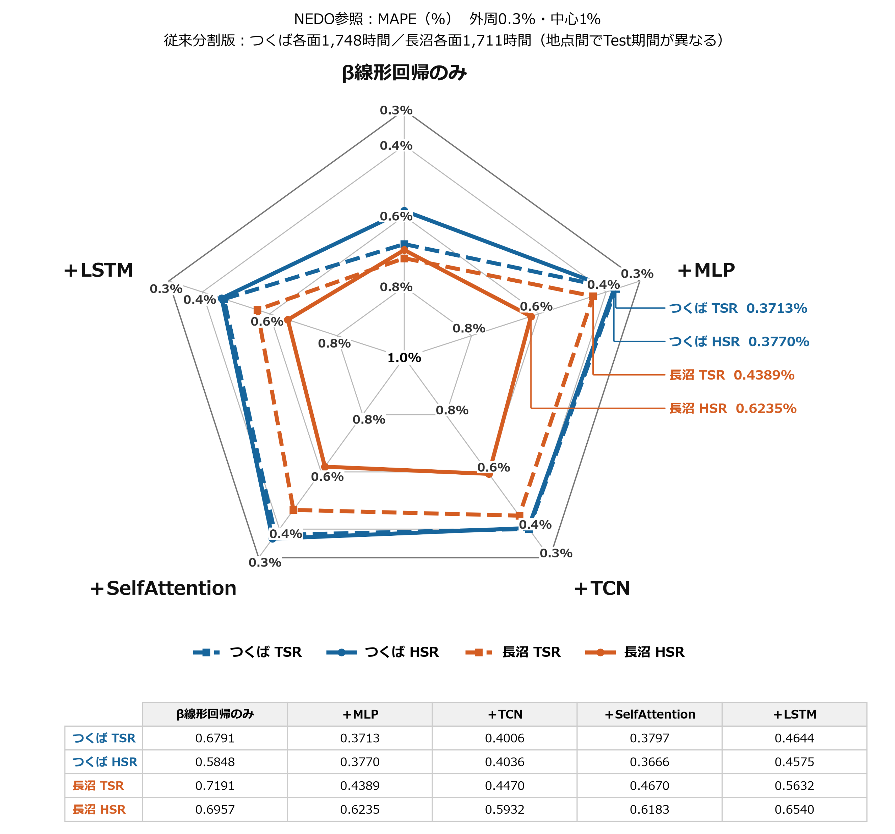
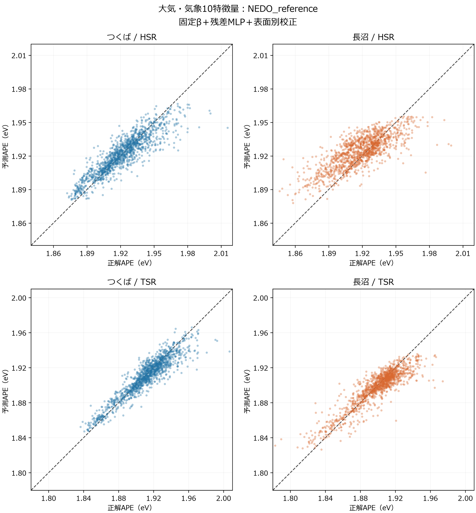
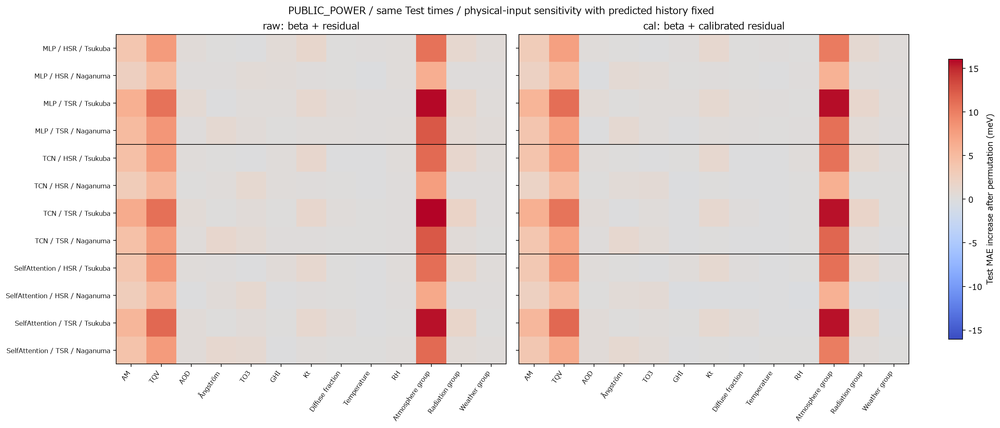

# 固定β＋残差MLP＋校正によるAPE予測 — 中間発表資料対応版

気象・大気パラメータから、太陽スペクトルの平均光子エネルギー（APE）を推定する研究です。固定係数のRidge回帰を基礎予測とし、残差をMLP等で補正して、独立した校正区間で表面別に校正します。

本ブランチは **『河西_中間発表資料_v1.pptx』の解析成果を保存した資料対応版**です。資料中の研究成果の図をPPTXから直接抽出し、表を転記しました。対象はつくば・長沼、水平面HSR／傾斜面TSR、**1時間平均APE**です。従来のつくば5大気変数版は[旧README](docs/historical/README_tsukuba_five_feature_main.md)と既存の`src/`・`scripts/`に残しています。

> **資料を読む際の条件**：レーダー図は地点別の従来分割（native）、散布図は共通時刻分割（common_hours）です。定量表には保存予測と一致しない値があります。以下に資料の表と検算値を別々に掲載します。主要図は **NEDO_reference（現地日射・気象の参照条件）** の結果であり、公開入力のみで同じ精度が得られたという結果ではありません。

## モデルと入力

APEは350–1050 nmの実測分光日射から算出した教師値を使い、有効な10分APEを1時間内で算術平均します。各時間に3点以上の有効観測があることを条件とします。HSR／TSRは、それぞれ水平面／傾斜面の直達・散乱を含む分光日射です。APEは平均光子エネルギーであり、スペクトルのピーク波長そのものではありません。

物理入力10種類は **AM、TQV、AOD550、Ångström指数、TO3、GHI、晴天度指数Kt、水平面散乱比、気温、相対湿度**。線形βには大気5変数を用い、残差モデルには物理10変数と時刻・季節・表面条件・β予測・過去1/2/3/6時間の自己予測残差等を与えます。MLPの最終入力は補助量を含め35列です。

| 入力条件 | 大気入力 | 日射・気象入力 | 用途 |
|---|---|---|---|
| PUBLIC_POWER | 既存のAM・MERRA-2大気変数 | NASA POWERの1時間値から構築 | 公開データを使う条件の評価 |
| NEDO_reference | 同じ大気変数 | NEDOの現地観測を1時間集約 | 参照比較。公開入力の結果とは区別 |

資料対応版の基礎予測は、面ラベルを $`s_i=0`$（HSR）、$`s_i=1`$（TSR）として、

```math
\widehat{\mathrm{APE}}_{\beta,i}
=
\beta_0+\sum_{j=1}^{5}\beta_j x_{i,j}
+s_i\left(\gamma_0+\sum_{j=1}^{5}\gamma_j x_{i,j}\right)
```

```math
\widehat{\mathrm{APE}}_i
=
\widehat{\mathrm{APE}}_{\beta,i}
+
\mathrm{clip}\left(
a_{s_i}\widehat{r}_i+b_{s_i},
-c_{s_i},
c_{s_i}
\right)
```

$`i`$ は観測行、$`j`$ は大気変数番号、$`x_{i,j}`$ はその値です。
$`\beta`$ はHSRの基礎係数、$`\gamma`$ はTSRとの差分係数、
$`\widehat{r}_i`$ はMLPが予測した残差です。

$`a_s,b_s,c_s`$ はCALだけから求める表面別校正係数です。
clipは、校正した残差補正量を下限 $`-c_s`$、上限 $`c_s`$ に制限する操作です。

両面をまとめ、交互作用を含む11列をTrainで標準化して、
Ridge回帰（α=1）を当てます。
**現在の新規解析方針（2026-11-10以降）は、各地点内のHSR／TSRでβの切片・大気係数を共通にすることです。** ここに収録した旧結果は資料との対応を保つため表面別βのまま保存しています。地点間のβ共通化や、今回の公開に伴う再学習は行っていません。

## 資料掲載：モデル比較レーダー（スライド12）



β単体と、MLP／TCN／Self-Attention／LSTMによる補正を比較。補正モデルはすべて校正後。指標はMAPE [%]で、小さいほど外側です（外周0.3%、中心1%）。**つくば各面1,748時間、長沼各面1,711時間で、地点間のTest期間は異なります。** 同一地点内のモデル比較は同じTestを使います。

| 地点 | 面 | βのみ | ＋MLP | ＋TCN | ＋SelfAttention | ＋LSTM |
| --- | --- | --- | --- | --- | --- | --- |
| 長沼 | HSR | 0.6957 | 0.6235 | 0.5932 | 0.6183 | 0.6540 |
| 長沼 | TSR | 0.7191 | 0.4389 | 0.4470 | 0.4670 | 0.5632 |
| つくば | HSR | 0.5848 | 0.3770 | 0.4036 | 0.3666 | 0.4575 |
| つくば | TSR | 0.6791 | 0.3713 | 0.4006 | 0.3797 | 0.4644 |

図と一致する値は[レーダー評価CSV](studies/interim_v1_20261113/radar_native_metrics.csv)、比較用の[共通時刻版CSV](studies/interim_v1_20261113/radar_common_hours_metrics.csv)に保存。MLPが全条件で最良という結果ではありません。

## 資料掲載：定量評価表（スライド13）

次の表は、資料に書かれた値をそのまま転記したものです。MBEの符号は資料に合わせて「予測−正解」です。

| 状況 | R² | 平均誤差率 | 平均誤差 | 予測バイアス（予測−正解） |
| --- | --- | --- | --- | --- |
| HSR（長沼） | 0.51 | 0.61% | 11.9 meV | +4.56 meV |
| HSR（つくば） | 0.78 | 0.38% | 7.27 meV | -0.50 meV |
| TSR(長沼) | 0.79 | 0.45％ | 8.33 meV | -0.47 meV |
| TSR（つくば） | 0.85 | 0.37％ | 7.11 meV | -1.00 mev |

**この表のMAE・MBEは、資料の散布図に対応する保存予測からの再計算値と一致しません。** R²・MAPEも分割を明示して読む必要があります。解析結果として利用する場合は、次の検算済み表を参照してください。

### 共通時刻・同一Test予測からの検算値

条件は `common_hours / NEDO_reference / MLP / cal`。各面1,326時間です。

| 地点 | 面 | Test点数 | R² | MAPE [%] | MAE [meV] | MBE [meV]：予測−正解 |
| --- | --- | --- | --- | --- | --- | --- |
| つくば | HSR | 1326 | 0.7809 | 0.3794 | 7.3101 | -0.2401 |
| つくば | TSR | 1326 | 0.8521 | 0.3677 | 7.0527 | -1.5654 |
| 長沼 | HSR | 1326 | 0.5051 | 0.6114 | 11.6950 | 5.3631 |
| 長沼 | TSR | 1326 | 0.7860 | 0.4453 | 8.4674 | -2.1206 |

R²は $1-\sum_i(y_i-\hat y_i)^2/\sum_i(y_i-\bar y)^2$、MAPEは $100\,\mathrm{mean}(|\hat y_i-y_i|/y_i)$、MAEは $\mathrm{mean}(|\hat y_i-y_i|)$、MBEは $\mathrm{mean}(\hat y_i-y_i)$。eVを1,000倍してmeVで表示します。元の解析CSVにある`mbe_truth_minus_prediction`とは符号が逆です。

全方式・公開入力・校正前後を含む[検算済み評価CSV](studies/interim_v1_20261113/verified_test_metrics.csv)と[資料との対応・相違](studies/interim_v1_20261113/図表対応と相違.md)を収録しています。

## 資料掲載：正解−予測散布図（スライド14・15）



資料ではこの画像の上段HSRと下段TSRを別スライドに配置しています。横軸は正解APE、縦軸は予測APE、破線は予測＝正解。NEDO_referenceのβ＋MLP＋校正で、両地点・各面とも同じTest 1,326時間です。高・低APE域の誤差が残り、特につくばより長沼HSRの散らばりが大きくなっています。これは原因を特定する結果ではありません。

## 資料掲載：特徴量感度（補足スライド21）



この図は **PUBLIC_POWERの共通時刻比較**です。各入力を入れ替えた際の最終予測MAEの増加量 [meV] を示します。赤いほど元の予測がその入力に依存し、青は入れ替え後にMAEが下がった条件です。βと残差補正を合わせた感度で、過去の自己予測残差は固定。3回の入れ替え・各面最大512点の推定です。末尾3列は変数群をまとめて入れ替えた結果で、個別列の合計ではありません。

資料では「アテンションマップ」と呼ばれていますが、この画像は **Permutationによる特徴量感度**です。Attention重みではなく、因果効果や各変数の物理的重要性を直接示すものでもありません。変数間の相関や非現実的な組合せの影響を含みます。

## 資料掲載：β係数表（補足スライド23）

以下は資料の表をそのまま転記した概数です。**nativeの表面別β**に対応し、共通時刻版のβとは異なります。

| 係数 | つくばHSR | つくばTSR | 長沼HSR | 長沼TSR |
| --- | --- | --- | --- | --- |
| 切片 β₀ | 1.937 | 1.911 | 1.904 | 1.888 |
| AM | −0.0131 | −0.0225 | −0.0044 | −0.0125 |
| TQV | 0.0008 | 0.0011 | 0.0007 | 0.0010 |
| AOD550 | −0.0122 | −0.0098 | 0.0075 | 0.0108 |
| Ångström指数 | −0.0077 | −0.0117 | −0.0234 | −0.0202 |
| TO3 | −0.00004 | 0.00003 | 0.00009 | 0.00011 |

丸め・転記差を含むため、計算には[元単位のβ係数CSV](studies/interim_v1_20261113/beta_effective_coefficients.csv)を使ってください。切片はeV、各傾きはeV／各特徴量の単位。TQVはkg m⁻²、TO3はDUです。標準化空間の係数・スケーラー、OOF fold、面別校正係数も`protocol/`・`models/`に保存しています。

## 評価条件と解釈

- 共通時刻版は8,876時間。Train 6,213、Early 657、CAL 662、Test 1,326時間／面で、境界のpurge区間を設けます。β・標準化・NNは地点別に学習し、時間順OOFで残差教師を作ります。
- 推論時の履歴は同じ面の過去の**自己予測残差**です。Testの実測APEを過去残差として入れません。Earlyで停止epochを選び、校正はCALだけで推定します。
- `raw`はβ＋未校正残差、`cal`はβ＋校正残差。β単体は`fixed_beta_5`です。MAEとR²の最良方式は一致しない場合があり、校正が全指標を改善するとも限りません。
- HSR／TSRで精度が異なる原因、低・高APE域の入力不足、βの地理的補間は検証すべき仮説です。感度図だけで機序や原因を断定しません。
- つくば32°・長沼36°が実際のTSR設置角です。当時の`tilt_angle_deg`の0/32は面を区別する従来の符号で、長沼の実角36°を使った入射角計算ではありません。
- 2地点内の時間順holdout・単一seedの結果です。未知地点のAPE精度、全国へのβ補間、太陽電池の年間発電量予測は今後の検証対象です。資料にあるβ=5/10/7.5の地理的補間図は構想図です。

## 成果物と再現

| 場所 | 内容 |
|---|---|
| [`studies/interim_v1_20261113/`](studies/interim_v1_20261113/) | この資料に対応する成果物一式 |
| `figures/` | 資料から抽出した研究結果図、元の散布図PNG/PDF/SVG |
| `predictions/` | 1時間平均APEのTest正解・保存予測。元スペクトル・観測入力は含めない |
| `models/` | 設定・校正・学習履歴、残っている学習済み重み、標準化係数JSON |
| `protocol/` | 時間分割、β回帰・OOF情報、標準化空間のβ |
| `source_snapshot/` | 実際に使用した旧解析・図作成コードのスナップショット |
| `original_reports/` | 当時の評価・結果考察（現在の方針とは区別） |
| `manifest.json` | 出典・ファイルSHA256・原本保全・数値検算情報 |

Python標準ライブラリだけで、保存Test予測からR²・MAE・RMSE・MAPE・MBEを再計算し、CSVと図の出典ハッシュを確認できます。

```bash
git clone --branch presentation/interim-v1-20261113 https://github.com/yukichacha0227-stack/ape-hybrid-fixed-beta-mlp.git
cd ape-hybrid-fixed-beta-mlp
python studies/interim_v1_20261113/verify_release.py
```

再学習には別途NEDO観測・大気データ等が必要です。旧コードのデータ契約・重みの利用・再現可能範囲は[再現手順](studies/interim_v1_20261113/再現手順.md)を参照してください。保存済み予測の検算と、同じ精度を再学習で再現することは別です。今回の公開時には再学習していません。

## 出典

資料：河西優希『気象・大気パラメータを用いたペロブスカイト太陽電池の発電量予測モデルの構築』中間発表資料v1（表紙日付2026-10-30）。研究結果の図・表のみを抽出・転記し、元のPPTXと第三者の背景図は含めていません。

観測：NEDO『日射スペクトルデータベース』（2018）。公開気象入力：[NASA POWER](https://power.larc.nasa.gov/)、大気入力：[NASA MERRA-2](https://gmao.gsfc.nasa.gov/reanalysis/MERRA-2/)。従来研究・応用物理学会発表へのリンクは[旧README](docs/historical/README_tsukuba_five_feature_main.md)にあります。

コードのライセンスは[MIT](LICENSE)。観測データと第三者資料には各提供元の条件が適用されます。
